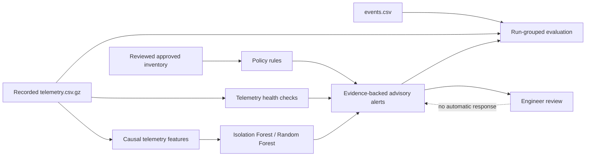

# Ziaxen ROS 2 Security & Sensor-Anomaly Agent
Offline advisory monitor for ROS 2 robots: sensor-noise anomaly detection plus ROS graph/telemetry security checks. Alerts only, no automatic action.

## What was inspected

The `ai-team-data` branch of
[FireMax-Bot/zaixen-isaac-sim](https://github.com/FireMax-Bot/zaixen-isaac-sim/tree/ai-team-data/AI_team_data)
contains `AI_team_data/dataset_index.csv`, dataset guides, 9 normal runs, and
297 attack runs across 17 documented attack types. All 306 index entries were
marked `completed`. The `noise` category has exactly 27 runs: levels L1/L2/L3,
NPC counts 10/20/30, and seeds 1/2/3. Each inspected run has `aligned.csv.gz`,
`telemetry.csv.gz`, `events.csv`, and `manifest.json`.

The inspected normal and L1 noise aligned files had 36 columns and about 4,560
rows each. The columns include `sim_time_ns`, `sim_time_s`, `t_rel_s`, IMU
orientation/angular velocity/linear acceleration, odometry pose/twist,
`*.age_s`, `*.stamp_lag_s`, contact data, and label/metadata columns
(`is_attack`, `attack_type`, `attack_target`, `attack_id`). Aligned sampling is
50 Hz. The noise sample had 1,500 active rows and matching `start` and `stop`
rows in `events.csv`; the implementation re-derives labels from those events
and checks them against the stored `is_attack` values.

The inspected noise manifest configures IMU `accel`, `gyro`, and
`orientation`, plus odometry `position`, `pose_orientation`, and `twist`.
The per-level settings are:

| Level | `k` for acceleration/gyro/speed | Odometry position | Yaw |
|---|---:|---:|---:|
| L1 | 0.5 x standard deviation | 0.10 m | 5 degrees |
| L2 | 1.0 x standard deviation | 0.30 m | 10 degrees |
| L3 | 3.0 x standard deviation | 0.50 m | 20 degrees |

Noise events start at 30 seconds and stop at 60 seconds of run elapsed time in
the inspected noise scenarios. Event timestamps are absolute simulation
nanoseconds; the inspection command also reports elapsed seconds from the
first aligned row for each run.

Telemetry is a 31-column 2 Hz table. It contains per-topic rates, publishers,
subscribers, gaps and stamp lag, graph/node counts, parameter/service events,
and collector counters. In the inspected normal run, `new_nodes` and the
contact stamp-lag mean were entirely missing; these are expected/understandable
for fields without a value and are not model inputs. Telemetry is retained and
profiled by dataset inspection, but is not fused into this 50 Hz
sensor-noise-specific model. It would be relevant to separate network-attack
detectors, especially for attacks 12–17.

The dataset guide says the sensors are idealized and noise-free outside the
simulated attack. It also says the ego vehicle is driven by an in-simulation
callback, not by ROS; this project is a recorded-data Python detector, not a
real-time ROS/CAN integration.

## Project map

- `config/dataset.json` — verified dataset layout, expected counts, run
  dimensions, and documented sampling rates.
- `src/ziaxen_agent/data.py` — indexed run discovery, metadata/events loading,
  event-derived labels, label validation, and sampling/schema inspection.
- `src/ziaxen_agent/features.py` — numeric IMU/odometry/contact features,
  per-second changes, and causal trailing variability.
- `src/ziaxen_agent/models.py` — Isolation Forest baseline, Random Forest
  comparator, threshold selection, metrics, and ranked feature context.
- `src/ziaxen_agent/training.py` — training and validation with whole seeds.
- `src/ziaxen_agent/evaluation.py` — untouched held-out seed evaluation,
  confusion matrix, per-run and per-level reports, and latency measurement.
- `src/ziaxen_agent/agent.py` — saved-model loading and row-wise inference.
- `src/ziaxen_agent/cli.py` — beginner-friendly commands.
- `tests/` — focused checks for event labels, temporal features, and input
  validation.
- `models/` and `reports/` — generated model bundle, reports, predictions, and
  confusion matrix (created by the commands below).

## Model and evaluation design

The baseline is an Isolation Forest trained using only event-confirmed normal
rows. The supervised comparator is a class-weighted Random Forest trained on
the normal/noise labels derived from `events.csv`. Both receive raw numeric
sensor values, first changes divided by actual simulation-time differences, and
trailing standard deviations over 25 aligned rows (0.5 seconds at 50 Hz).
Features are causal and do not look into future rows. Missing feature values
are median-imputed using training data. Time, IDs, labels, and scenario metadata
are never model inputs.

Whole runs are separated by the dataset seed: candidate models are initially
fit on seed 1, and seed 2 selects the model and its operating threshold. After
that selection, the saved final candidates are refit on both seed 1 and seed 2
(24 runs total); seed 3 (12 runs) remains held out for final evaluation. The
saved threshold is the one selected on seed 2 using the initial seed-1 models.
No row-wise random split is used. Because there are only three seeds, this is
a single fixed run-group split, not a broad external validation. The same
class/level/NPC scenario definitions recur in all three seeds, so seed 3 is a
held-out replicate, not an unseen-scenario test.
The evaluation reports precision, recall, F1, false-positive rate, confusion
matrix, average precision, missed/detected noise runs, and detection latency
from the event start to the first alert. Latency averages exclude missed runs
and are labelled accordingly.

The selected model is whichever candidate has the better seed-2 validation F1
(then lower FPR). Inference scores are not probabilities for Isolation Forest.
Each alert includes the score, threshold, timestamp, original non-sensor
metadata, and the strongest deviations from the training normal feature
reference. These ranked features are diagnostic context, not causal proof.

## Setup in VS Code (Windows PowerShell)

1. Download/clone the dataset repository branch. For example, from a parent
   folder:

   ```powershell
   git clone --branch ai-team-data --single-branch https://github.com/FireMax-Bot/zaixen-isaac-sim.git
   ```

   The data root is the resulting `zaixen-isaac-sim\AI_team_data` folder. This
   project does not copy the full dataset into its source tree.

2. Open `noise_detection_agent` in VS Code, select a Python 3.10+ interpreter, and
   open the integrated PowerShell terminal.

3. Create and activate an environment, then install dependencies:

   ```powershell
   py -3 -m venv .venv
   .\.venv\Scripts\Activate.ps1
   python -m pip install --upgrade pip
   pip install -r requirements.txt
   ```

   If PowerShell blocks activation, use
   `.\.venv\Scripts\python.exe -m pip install -r requirements.txt` and prefix
   the commands below with `.\.venv\Scripts\python.exe`.

4. Add this project’s `src` directory to `PYTHONPATH`, then inspect the dataset
   before training (replace the example path):

   ```powershell
   $env:PYTHONPATH = "$PWD\src"
   python -m ziaxen_agent.cli inspect --data-root "C:\path\to\zaixen-isaac-sim\AI_team_data"
   ```

5. Train, evaluate, and run inference:

   ```powershell
   python -m ziaxen_agent.cli train --data-root "C:\path\to\zaixen-isaac-sim\AI_team_data"
   python -m ziaxen_agent.cli evaluate --data-root "C:\path\to\zaixen-isaac-sim\AI_team_data"
   python -m ziaxen_agent.cli infer --input "C:\path\to\recording.csv.gz"
   ```

   Training writes `models/noise_detector.joblib` and
   `reports/training_validation.json`. Evaluation writes
   `reports/evaluation_report.md`, `reports/evaluation_report.json`,
   `reports/confusion_matrix.png`, `reports/predictions.csv`,
   `reports/scenario_metrics.csv`, and `reports/noise_level_metrics.csv`.
   Inference prints one JSON object per input row; use `--output alerts.jsonl`
   to save those objects. Override the operating threshold with
   `--threshold 0.5` (the value is model-score-specific).

6. Run focused tests:

   ```powershell
   $env:PYTHONPATH = "$PWD\src"
   python -m pytest
   ```

Alternatively, run `pip install -e .` once and use the `ziaxen-agent` command
without setting `PYTHONPATH`.

## ROS 2 telemetry security monitor (offline replay)

The security monitor is a separate, read-only extension. It replays the
dataset's 2 Hz `telemetry.csv.gz` files, applies explicit inventory rules, and
can compare those rules with telemetry anomaly-model baselines. It does not
connect to ROS, publish messages, call services, change parameters, block
traffic, or stop a vehicle. It complements—not replaces—SROS 2/DDS-Security,
network segmentation, authenticated identities, topic permissions, and
bridge hardening.



### Dataset audit and setup

The security pipeline uses the documented
[Ziaxen Isaac Sim `ai-team-data` branch](https://github.com/FireMax-Bot/zaixen-isaac-sim/tree/ai-team-data/AI_team_data).
Set `ZIAXEN_DATA_ROOT` to the local `AI_team_data` folder (the folder
containing `dataset_index.csv`) or pass `--data-root` to each dataset command.
The inventory bootstrap scans normal runs and writes a **draft**. Review every
value against the real, authorized system before changing
`approval_status` to `approved`; `security-scan` rejects drafts.
The current bootstrap does not restrict those inputs to training seeds: it
uses normal telemetry across seeds 1-3 for rate/gap/lag limits and all indexed
manifests for domain IDs. Do not treat its inventory or seed-3 rule metrics as
strictly training-only; see `reports/leakage_audit.md` for the measured impact.
For a training-only inventory, the Python API accepts an explicit seed set,
for example `bootstrap_inventory(data_root, output_path, seeds={1, 2})`.

For local recorded-file demonstrations only, `security-scan --offline-demo`
also accepts an inventory marked `approved_for_offline_demo` when its reviewer
is exactly `PENDING HUMAN REVIEW`. This state is not production approval and
cannot be used without the explicit offline-demo flag. The scanner accepts a
local telemetry file only and has no live ROS or network source.

```powershell
$env:PYTHONPATH = "$PWD\src"
python -m ziaxen_agent.cli security-inspect --data-root "C:\path\to\AI_team_data"
python -m ziaxen_agent.cli bootstrap-inventory --data-root "C:\path\to\AI_team_data" --output "config\approved_inventory.example.json"
python -m ziaxen_agent.cli security-train --data-root "C:\path\to\AI_team_data"
python -m ziaxen_agent.cli security-evaluate --data-root "C:\path\to\AI_team_data" --inventory "config\approved_inventory.example.json"
python -m ziaxen_agent.cli security-scan --input "C:\path\to\telemetry.csv.gz" --inventory "config\approved_inventory.offline_demo.json" --manifest "C:\path\to\manifest.json" --offline-demo --output "alerts.jsonl"
```

`security-evaluate` is an offline benchmark and records whether the supplied
inventory is still a draft. `security-scan` is stricter and requires a
human-reviewed inventory marked `approved`, except for the explicitly gated
`approved_for_offline_demo` state above. Commands only read local files.
The audit writes `reports/security_dataset_inspection.json` and
`reports/security_dataset_inspection.md`; evaluation writes
`reports/security_evaluation_report.{json,md}` plus prediction, event,
per-run, NPC/level, class, and alert CSVs. The separate security model bundle
is `models/security_detector.joblib`; the existing noise model bundle and
commands are unchanged.

### Inventory format

`config/approved_inventory.example.json` is intentionally a draft. It records
the ROS distribution, RMW, domain IDs, discovery-server endpoint, nodes,
topic publisher/subscriber count limits, observed normal rate/gap/lag bands,
and per-topic safety-critical flags. `msg_type: "unknown"` means the dataset
does not provide an authoritative type; confirm it before approval. The
bootstrap also records normal node-list hashes so a later hash can be compared
with known normal recordings. Host names and enclave identities are left
unset because they are not in the dataset.

Topic rules are disabled for `rate_hz`, `max_gap_s`, or `max_stamp_lag_s` when
the corresponding inventory value is `null`. `max_late_count` and
`safety_critical` are topic-specific. Parameter/service limits and approved
maintenance windows are configured under `limits` and
`approved_change_windows`. The bootstrapped values are proposals from
recorded simulations, not production policy.

### Alert format

Each JSONL alert has a stable `alert_id`, simulation timestamp, run, source and
rule/model, affected entity (or `null` when unknown), evidence, severity, and
an investigation-only next step. It also states what the observation does not
prove and always sets `requires_human_approval: true` and
`automatic_action_taken: false`.

```json
{
  "source": "policy",
  "rule_or_model": "subscriber_count_above_policy",
  "affected": {"type": "topic", "name": "/imu_mon"},
  "evidence": {
    "column": "imu_mon.sub_count",
    "observed_count": 3,
    "approved_max_count": 2
  },
  "what_this_does_not_prove": "A subscriber count increase does not identify the subscriber or prove that payloads were read.",
  "severity": "high",
  "recommended_next_step": "Inspect endpoint identities using an authorized ROS graph source and verify the topic policy.",
  "requires_human_approval": true,
  "automatic_action_taken": false
}
```

### Threat coverage and evidence boundaries

| Concern / dataset class | Signal | Current status |
|---|---|---|
| Unknown ROS node (`unauthorized_node`, 14) | `new_nodes`, node count, approved node hashes | Rule-based and evaluated on held-out simulated runs |
| Unexpected subscriber (`unauthorized_subscription`, 15) | subscriber count and new-node metadata | Rule-based and evaluated; count does not prove payload access |
| Extra publisher / spoof (`spoof`, 13) | publisher count, node metadata, rate | Rule-based and evaluated |
| Flood (`flood`, 12) | per-topic rate and gap | Rules and ML evaluated |
| Delay, drop, duplicate, clock skew (8–11) | aggregate rate, gap, lag, late counts | Limited telemetry resolution; evaluated as diagnostics |
| Parameter tampering / service abuse (16–17) | parameter/service counters, node graph | Limited and evaluated; dataset guide calls these deliberately weak targets |
| Sensor values (1–7) | Existing aligned sensor-noise model handles only noise | Not covered by the telemetry detector; other sensor classes are not claimed |
| Unknown host/device | No IP, MAC, hostname, or participant GUID | Not observable in these recordings |
| Movement-command publication/read | No command topic in the dataset | Not observable; safety-critical policy path has synthetic unit tests only |
| Live bridge/domain changes | Static manifest configuration only | Static mismatch checks only; runtime changes are not evaluated |

| Telemetry evidence | Can support | Cannot establish |
|---|---|---|
| `new_nodes`, node count/hash | A graph node name/count/hash differs from the inventory | The device/host identity or who added it |
| `pub_count`, `sub_count` | Endpoint counts exceed policy | Which endpoint is responsible or whether payloads were received/read |
| Rates, gaps, stamp lag, late counts | Timing/volume changed | Malicious intent or a specific network cause |
| Parameter/service counters | The collector observed activity | Caller identity; `service_call_count` is team instrumentation |
| Manifest domain/discovery values | Static recorded configuration differs | The live runtime configuration |

### Data and validation limits

The audit inspected 306 completed runs: 9 normal and 297 attacks across 17
classes. It found 1,396,469 aligned rows and 58,418 telemetry rows. The
telemetry detector trains on normal data and the classes with useful telemetry
signals (`flood`, `spoof`, `unauthorized_node`, and
`unauthorized_subscription`); candidate selection/thresholds use seed 2 and
seed 3 remains held out by whole run. The event file is the label authority.
The audit found stored telemetry labels disagreeing with event-derived labels
in 12 runs, so stored labels are not used for training or evaluation.

The held-out security results and per-class metrics are in the evaluation
report. They are evidence only for this simulated dataset and its recorded
configuration. The 2 Hz collector, small number of runs, coarse rogue-program
event boundaries, idealized sensors, and lack of real host identities limit
generalization. High anomaly scores are not probabilities. Per-class metrics
for classes not used as supervised training positives are diagnostic, not
validated coverage. The offline detector has no real-time, live-ROS, or
real-vehicle performance claim.
Event-level recall includes 95% Wilson score intervals. Three events per class
for spoof, unauthorized node, and unauthorized subscription are too few to
claim reliable performance.

The dataset recordings use ROS 2 Humble, `rmw_fastrtps_cpp`, and Fast DDS
2.6.x. Its manifests include local domain IDs 60–63 and simulation domain 0.
The dataset guide says the sensors are idealized and the ego vehicle is not
driven by ROS. `raw_clean.csv` is verification-only and is never read for
training.

### External sensor CSV adapter

`ziaxen_agent.external_adapter.adapt_external_csv` maps recognized IMU,
odometry/position, and velocity columns to the frozen noise model, resamples
to 50 Hz, and writes a mapping JSON when `mapping_path` is supplied. Pass
source units explicitly when they are not SI; the adapter does not infer a
coordinate-frame transform or vehicle calibration. More than half of the
model's raw sensor columns missing makes a dataset not applicable. External
metrics are transfer estimates, not evidence of real-world performance. The
current checkout contains no `external_data/` recordings, so none were scored.

### Hardening recommendations and roadmap

The dataset repository's setup notes report a Discovery Server listening on
`0.0.0.0`, an Isaac Python server on port 8226 described as unauthenticated in
that setup, and no SROS 2 configuration. Treat these as configuration-review
items, not attacks proved by the telemetry. In an authorized environment,
review interface binding, firewall/segmentation, bridge endpoints, and
SROS 2/DDS-Security policies. A Discovery Server is not itself access control.

1. **Offline replay (implemented):** inspect recordings, compare approved
   inventory rules and models, and review alerts.
2. **Owned simulation (future):** collect participant GUID-to-host mappings,
   command-topic activity, bridge/domain changes, and SROS 2 enabled/disabled
   results using explicitly authorized scenarios and a read-only collector.
3. **Permissioned pilot (future):** validate on a test vehicle with written
   approval, privacy controls, a false-alert budget, and human-only response.
   Do not enable automatic action without a separate safety case.

For ROS 2 security, consult the
[Humble security concepts](https://docs.ros.org/en/humble/Concepts/Intermediate/About-Security.html),
[SROS 2](https://github.com/ros2/sros2), and the
[OMG DDS Security specification](https://www.omg.org/spec/DDS-SECURITY/).

## Blind evaluation (offline)

## Detector v2

Detector v2 is an optional advisory profile (`monitor --profile v2`) stored in
`config/v2/` and `models/v2/`; the default v1 profile and its model files are
unchanged. Run `scripts/build_v2.py` with the dataset root to fit limits from
seed-1 normal data, select conservative limits on seed 2, and create the
seed-1/2 inventory with `bootstrap_inventory(..., seeds={1, 2})`. Seed 3 is
reserved for the final evaluation.

The v2 rules provide evidence for flatlines (`freeze`), large causal first
differences (`jump`), stamp-lag offsets (`clock_skew`), and implausible contact
flags (`false_contact`). Every alert includes the observed column/value and
the frozen limit, remains advisory, and sets `automatic_action_taken` to
`false`. Replay and slow bias drift remain reported as unsupported until a
stable signal is demonstrated from the recorded channels. `missed_contact` is
reported as undetectable when the recordings contain no independent collision
signature; tuning on seed 3 is not used to change that conclusion.

The blind monitor accepts one or both recorded inputs without requiring the
attack class or run name. It strips ground-truth and identity columns before
inference, combines the frozen sensor-noise and telemetry detectors, and writes
time-ordered advisory incidents. If either input is omitted, the CLI warns and
prints a coverage map identifying the unavailable detector(s); this is reduced
coverage, not a clean bill of health. Alerts require human review and never
trigger automatic action.

```powershell
$env:ZIAXEN_DATA_ROOT = "C:\path\to\AI_team_data"
python -m ziaxen_agent.cli monitor --aligned "C:\path\to\aligned.csv.gz" --telemetry "C:\path\to\telemetry.csv.gz" --inventory "config\approved_inventory.example.json" --allow-draft-inventory-for-offline-eval --output "reports\monitor_alerts.jsonl"
python -m ziaxen_agent.cli build-blind-streams --output-dir "reports\blind_streams"
python -m ziaxen_agent.cli evaluate-blind-streams --stream-dir "reports\blind_streams" --inventory "config\approved_inventory.example.json" --allow-draft-inventory-for-offline-eval
python -m ziaxen_agent.cli blind-robustness --stream-dir "reports\blind_streams" --inventory "config\approved_inventory.example.json" --allow-draft-inventory-for-offline-eval
python -m ziaxen_agent.cli leave-one-class-out --inventory "config\approved_inventory.example.json" --allow-draft-inventory-for-offline-eval
```

Stream A uses all seed-3 normal-only segments plus fixed-seed sampled complete
attack windows to approach 5% attack time. Stream B contains every seed-3 run
in three fixed shuffles. Stream C contains only seed-3 normal data and is used
for the soak and stress tests. Each manifest records source slices, offsets,
join points, and event-derived ground-truth intervals; detector inputs contain
no label or run-identity columns. Collector counters are differenced per
segment. Reports compare continuous detector state with state reset at each
join and score events using a 1.5 s pre-start / 0.5 s post-stop tolerance.
Sensor-noise levels in the stress suite are explicitly documented assumptions,
not specifications for a production sensor. The telemetry jitter health check
uses an unvalidated 0.05 s deviation heuristic, not a sensor or network
specification.

These are simulated blind-stream estimates, not real-world performance claims:
the simulator sensors are idealized and its driver is not ROS-driven. Real-world
claims require recordings from an owned test vehicle or robot, collected with
written approval, real sensor noise, and a ROS-driven controller. Collection
must also preserve privacy and system-owner authorization. Draft inventory use
is blocked unless the explicit offline-evaluation flag is supplied; that flag
does not constitute approval for deployment.

## Quick presentation demo

The demo loads the saved Random Forest and compares one normal seed-3 recording
with one L1 noise seed-3 recording. It uses the existing inference pipeline and
does not retrain the model:

```powershell
python scripts\demo.py --data-root "$env:TEMP\ziaxen_noise_dataset\AI_team_data"
```

By default, it reads `normal_data/normal_npc10_seed3/aligned.csv.gz` and
`abnormal_data/01_noise/noise_L1_npc10_seed3/aligned.csv.gz` under the supplied
data root. It shows each file’s predicted class, peak per-row anomaly score,
saved threshold, and number of rows flagged, then prints a comparison. The
threshold is read from the model bundle and displayed to four decimal places;
it is not separately hardcoded.

## Missing files, assumptions, and limitations

- The inspected branch index lists 306 completed runs, and the checked normal
  and noise run folders contain all four expected files. The loader reports
  missing indexed files and does not silently skip them.
- Across the 36 loaded normal/noise runs, inspection covered 164,235 aligned
  rows and 6,869 telemetry rows. The aligned table had no missing values. In
  telemetry, `contact_mon.stamp_lag_mean_s` and `new_nodes` were fully empty;
  IMU/odometry stamp-lag means had 0.75702% missing values.
- File-by-file validation in this project covers the 9 normal and 27 noise runs
  used here. Other attack folders are inventoried in the index but are not
  loaded or file-validated by this noise-focused pipeline.
- `raw_clean.csv` is not present in this branch and, per its data guide, must
  never be used for training. No clean-truth stream is assumed.
- This project uses only the 9 normal runs and 27 `noise` runs; it does not
  train on or claim coverage of bias/drift, timing, contact, network, or other
  attack classes.
- Scenario labels come from `events.csv` using start-inclusive, stop-exclusive
  `sim_time_ns` intervals. Stored `is_attack` is checked for agreement but is
  not the training label source.
- Initial missing feature values (for example, causal differences at the first
  row) are imputed from training medians. Input columns absent from a recording
  are surfaced in each prediction’s `input_warnings`; unexpected sensor fields
  are ignored by the trained feature schema and surfaced there as well.
- Contact stamp lag and some telemetry values can be entirely empty because
  those data do not have a message timestamp/value. They are preserved in
  loaded inputs but not used as features for this task.
- Simulation results on idealized data can substantially overstate real-world
  performance. No safety-critical, real vehicle, ROS, or CAN claims are made.
